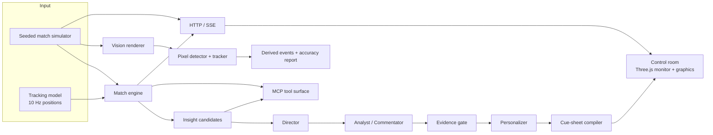

# Architecture

Floodlight is one pipeline with several delivery surfaces. The same deterministic
match model feeds the live control room, the cue-sheet renderer, the vision
report, the HTTP API, the MCP tools and the portable dataset.

## 1. Simulation and tracking

`packages/simulator` is the source of truth for a match. A seeded PRNG drives
possession chains, passes, carries, duels, shots, set pieces, cards,
substitutions and VAR decisions. The same seed produces the same event stream
on every machine.

A separate positional model turns those events into a continuous tracking
timeline. Event coordinates are authoritative: the ball reaches the recorded
release/receipt point at the recorded time, players move at speeds derived from
displacement, and a tracking window computed from 0–600 s matches the same
timestamps requested as 0–600 s plus 600–660 s. Substitutions keep the outgoing
player's station and individual fatigue rather than inheriting a full-match
load.

The simulator is explicitly synthetic. It is football-realistic, not a claim
about a real competition: fictional clubs and players, plausible ranges
asserted by the calibration fixture, no real match or player data.

## 2. Football interpretation

`packages/engine` reduces the event stream to:

- time-weighted possession and territory;
- progressive passes and line breaks in attack-normalised coordinates;
- expected threat (xT), control-vs-chaos, rhythm and momentum;
- pressure phases, high turnovers and a scoped PPDA reading;
- fourteen insight kinds, each with the evidence event IDs that raised it.

Metrics are defined with a subject, a side of the pitch and a time window. The
heuristic shot model is called xG throughout the interface but is a synthetic
estimate, not a trained model or an empirical calibration against real football.

## 3. Production crew and evidence gate

`packages/agents` runs a named crew:

| Role | Responsibility |
| --- | --- |
| Director | Priority, TTL, slot assignment and retraction. |
| Analyst | Drafts (or templates) the headline and body from a typed brief. |
| Commentator | Writes the ticker line. |
| Verifier | Checks numeric and entity claims against scoped evidence facts. |
| Personalizer | Produces persona/language variants from approved copy. |

The director and verifier are deterministic. A model gateway is optional; when
it is absent the crew produces deterministic evidence templates. When a model
draft is used, it is checked against structured facts (metric, subject, unit,
time), not against a bag of numbers. A draft that cannot be bound to evidence is
rejected and replaced by the template path. Recorded studio audio is bound to
the event stream that produced it; a recording from another match or seed is
never substituted into a story and labelled as verified.

The browser worker runs this crew in-process while reading facts through a real
in-process SDK MCP transport. The same tool surface is exposed over stdio and
Streamable HTTP in `services/mcp`.

## 4. Cue sheet and replay

`packages/cuesheet` compiles approved moments into timed cues: lower thirds,
stat bumpers, momentum ribbons, telestration, player tags and goal flashes.
Exclusive slots, priorities, TTLs and expiry are enforced at compile time; a
cue from a retracted story is dropped.

The web app (`apps/web`) precomputes a match in a worker and replays it against
a theatre clock. The renderer reads tracking frames through a small rolling
cache and draws them imperatively, outside React state. Match facts on screen
are filtered to the playhead: a provisional goal counts until the linked VAR
decision, then the score rolls back at that decision. Spoiler-free mode hides
future rundown rows, future score markers and future vision analysis until the
viewer reaches them.

## 5. Vision

`packages/vision` renders a sensor image from the simulation, then discards the
simulation's knowledge. A palette learner, blob detector, tracker and event
state machine re-derive passes, shots, possession and speeds from pixels. The
report card scores those derivations against the simulator's ground truth and
shows misses as misses. This is a demonstration of the perception contract on
synthetic pixels, not a claim of broadcast-video generalisation.

## 6. Delivery surfaces

| Surface | Entry point | Notes |
| --- | --- | --- |
| Web control room | `npm run dev` | Vite + React + Three.js; worker pipeline. |
| HTTP / SSE API | `npm run api` | `services/api`, zero runtime deps. |
| MCP stdio | `npm run mcp` | External agent hosts. |
| MCP HTTP | `POST /mcp` on the API | Stateless Streamable HTTP. |
| Dataset | `npm run export:dataset` | JSONL, CSV, cue sheet, data card. |
| Vision report | `GET /matches/vision` | Same scorer as the web lab. |

## 7. Determinism and failure behaviour

Given a seed, the simulator, engine candidates, cue sheet and raster outputs are
byte-stable. Tests assert this at the package boundaries. The production path is
fail-closed: a model outage, an unparseable draft or stale evidence falls back to
a deterministic template; an unbound recording is not aired. The live UI
surfaces provider state rather than claiming a model ran when it did not.
